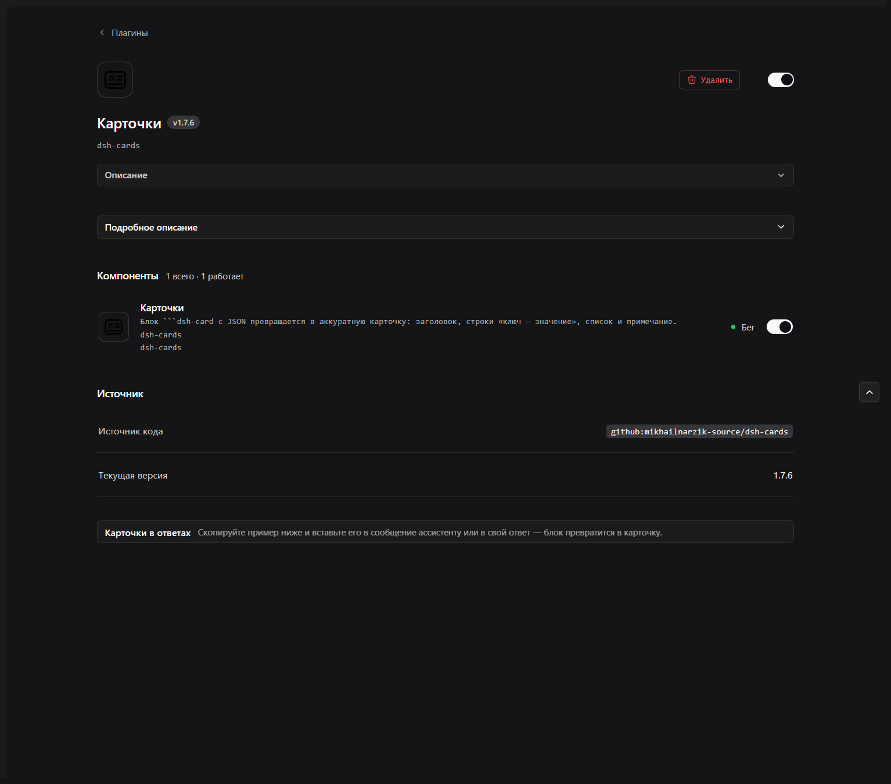

# dsh-cards

Аккуратные карточки в ответах ассистента: вместо простыни текста — компактная
сводка с заголовком, строками «параметр — значение», списком и кнопками действий.



*Страница плагина в интерфейсе DSH.*

## Что это и зачем

DSH (DeepSeek Harness) — приложение, в котором вы переписываетесь с ассистентом.
Ассистент отвечает текстом в Markdown: заголовки, списки, блоки кода.

Плагин `dsh-cards` добавляет ещё один вид блока — `dsh-card`. Внутри блока обычный
JSON. Когда такой блок появляется в ответе, вместо текста рисуется карточка:
заголовок, подзаголовок, строки «ключ — значение», маркированный список и
примечание.

Зачем это нужно: итог проверки, статус задачи, версии, результаты тестов удобно
читать одной карточкой, а не искать в абзацах. А ещё карточка умеет показывать
кнопки: скопировать команду, открыть файл, показать папку, открыть ссылку,
опубликовать репозиторий. Так рутинная работа делается без терминала.

Плагин только рисует. Ничего не выполняется само: пока вы не нажмёте кнопку,
карточка — просто картинка из текста.

## Как открыть

1. Левая панель → «Плагины».
2. Найдите в списке «Карточки» (пакет `dsh-cards`) и откройте страницу плагина.
3. Раздел «Карточки в ответах» открыт сразу: шапка с иконкой 🧩 и статус-чипом,
   ниже карточки-секции «Пример» и «Предпросмотр». Кнопка-шеврон в шапке
   сворачивает страницу до одной строки.

Внутри: слева поле с примером JSON, справа живой предпросмотр, внизу кнопка
«Скопировать пример».

Карточки в переписке работают сами — открывать плагин для этого не нужно.

## Как пользоваться пошагово

**Сценарий 1. Карточка-ответ.**

1. Попросите ассистента выдать итог карточкой (готовая фраза — в «Примеры»).
2. Ассистент пришлёт блок `dsh-card` с JSON внутри.
3. Блок превратится в карточку. Ожидаемый результат: заголовок, строки,
   список, внизу примечание; ширина по тексту, ничего не разъехалось.
4. Если в JSON ошибка, блок останется обычным текстом. Ответ не сломается.

**Сценарий 2. Свой JSON с предпросмотром.**

1. Откройте раздел «Карточки в ответах» на странице плагина.
2. Правьте JSON в левом поле.
3. Справа сразу обновляется карточка. При ошибке на её месте написано
   «Не удалось прочитать блок: причина».
4. Нажмите «Скопировать пример» — в буфер попадёт готовый блок вместе с
   обрамлением ```dsh-card.
5. Вставьте его в сообщение ассистенту или в свой ответ.

**Сценарий 3. Кнопки в карточке.**

1. В карточке есть кнопки (они появляются, если в JSON есть `file`, `folder`,
   `url`, `repo`, `command` или массив `actions`).
2. Нажмите кнопку. Пока действие идёт, на ней написано «выполняю…».
3. Результат: у действий с проверкой итога кнопка становится зелёной и меняет
   подпись на «<название> снова», при ошибке — красной. Текст ошибки виден под
   кнопками.

## Примеры

**Простая карточка.** Вставьте в сообщение такой блок (внешние четыре обратные
кавычки нужны только чтобы показать блок здесь):

````
```dsh-card
{
  "title": "Проверка релиза",
  "subtitle": "плагин dsh-sessions",
  "rows": [
    { "label": "Версия", "value": "1.0.20" },
    { "label": "Тесты", "value": "36 / 36" }
  ],
  "list": ["Собрать пакет", "Опубликовать в GitHub"],
  "note": "Заметка мелким шрифтом",
  "tone": "success"
}
```
````

**Фраза для ассистента.** Скопируйте и допишите своими данными:

> Покажи итог карточкой dsh-card: заголовок «Проверка релиза», строки «Версия» и
> «Тесты», список оставшихся шагов, тон success.

**Карточка с командой.** Внизу появится команда и кнопка «Копировать команду»:

```json
{
  "title": "Установка плагина",
  "command": "dsh plugin --profile desktop add github:mikhailnarzik-source/dsh-cards",
  "note": "Выполните в терминале и перезапустите DSH"
}
```

**Карточка с файлами и ссылкой.** Появятся кнопки «Открыть файл», «Сохранить
как…», «Открыть в папке», «Открыть ссылку», «Скачать файл» и кнопка
«Открыть с помощью…»:

```json
{
  "title": "Отчёт",
  "file": "C:/Users/user/Documents/README.md",
  "folder": "C:/Users/user/Documents",
  "url": "https://github.com/mikhailnarzik-source/dsh-cards"
}
```

Пути указывайте полные и внутри разрешённых каталогов: рабочая папка DSH, `~/.dsh`,
«Документы», «Рабочий стол», «Загрузки». Относительный путь считается от каталога
приложения, а не от вашей папки, — так лучше не делать. В примерах путь условный:
подставьте свой.

**Карточка с публикацией.** Кнопка «Опубликовать» делает `git push origin
HEAD:main` в указанном каталоге:

```json
{
  "title": "Публикация плагина",
  "repo": "C:/Users/user/Documents/projects/dsh-cards",
  "note": "Отправит текущую ветку в main"
}
```

**Свои кнопки.** Массив `actions` — пары «подпись + действие»:

```json
{
  "title": "Проверки",
  "actions": [
    { "label": "Тесты", "kind": "run-tests", "target": "C:/Users/user/Documents/projects/dsh-cards" },
    { "label": "Копировать", "kind": "copy", "command": "npm test" }
  ]
}
```

## Что вы увидите

Карточка в переписке:

| Элемент | Как выглядит |
|---|---|
| Цветная полоса слева | тон карточки: `info` — синий, `success` — зелёный, `warning` — оранжевый, `danger` — красный |
| Заголовок | жирная строка сверху |
| Подзаголовок | мелкая строка под заголовком |
| Строки `rows` | слева подпись, справа жирное значение |
| Список `list` | маркированные строки |
| Примечание `note` | мелкий текст под списком |
| Команда | тёмный блок с текстом команды |
| Кнопки | ряд кнопок под карточкой: 36 px, радиус 10, мягкая заливка brand с текстом brand |

Страница плагина: шапка с иконкой 🧩, заголовком «Карточки в ответах»,
подсказкой, статус-чипом («Разбирается» / «Ошибка») и кнопками «Обновить» /
«Свернуть», ниже — две карточки-секции: «Пример» (поле JSON и «Скопировать
пример») и «Предпросмотр» (живая карточка или причина ошибки). Контент по центру
шириной до 960 px; сетка карточек — `auto-fit`, поэтому 1280/1024/768/480 px
перестраиваются без горизонтальной прокрутки: на 900 px — одна колонка, на
640 px — компактные поля.

Кнопки страницы и карточки — единая система: высота 36 px (в шапке 32), радиус
10, ширина по тексту, primary — мягкая заливка brand 18% с рамкой brand 55% и
текстом brand, secondary — прозрачная с рамкой, danger — мягкая красная.
Белый текст на белом фоне не используется: в тёмной теме brand сам белый, поэтому
старые кнопки `button-primary-fill` выглядели нечитаемо. Строки кнопок
переносятся (`flex-wrap`), карточки в ряду одной высоты, футер прижат к низу.

## Частые ошибки и что делать

| Симптом | Причина | Что делать |
|---|---|---|
| В ответе виден текст блока, а не карточка | JSON невалиден, пустой или блок называется не `dsh-card` | Проверьте JSON в предпросмотре; блок должен начинаться с ```` ```dsh-card ```` |
| В предпросмотре «Не удалось прочитать блок: …» | синтаксическая ошибка JSON | Текст ошибки подсказывает место: лишняя запятая, кавычки, комментарии (их в JSON нет) |
| Карточка пустая или её нет | нет ни заголовка, ни строк, ни списка, ни примечания | Добавьте хотя бы одно поле |
| Пропала часть строк | у строки пусты и `label`, и `value` — она отбрасывается | Заполните хотя бы одно из двух |
| «нечего копировать» | в карточке нет `command`, `code` или `commands` | Добавьте команду, кнопка копирования появится сама |
| «путь вне рабочей папки» | кнопка пытается работать с файлом вне разрешённых каталогов | Укажите полный путь внутри рабочей папки DSH |
| «нет программы для этого типа файла» | у расширения нет ассоциации в Windows | Нажмите «Открыть с помощью…» и выберите редактор |
| «Сервер ответил 404» при скачивании | ссылка устарела | Проверьте ссылку в браузере |

## Ограничения и безопасность

- Плагин только отображает JSON. В сеть он ничего не отправляет: карточка
  рисуется целиком в браузере.
- Кнопки-действия рассчитаны на Windows и работают только с путями внутри
  разрешённых каталогов (список задан в `index.js`: рабочая папка DSH и несколько
  пользовательских папок). Остальные пути отклоняются с понятным сообщением.
- «Опубликовать» — это `git push origin HEAD:main`: текущая ветка уходит в `main`
  без дополнительного вопроса. Пользуйтесь, когда уверены в каталоге.
- «Тесты» запускают `node --test` в указанном каталоге. Другие команды не
  подставляются.
- Установка и обновление плагинов из карточки принимают только спецификации
  вида `github:mikhailnarzik-source/<репозиторий>`.
- Скачивание разрешено только по `http`/`https`; файл сохраняется в папку
  «Загрузки» под очищенным именем.
- Карточка не выполняет произвольный код и не запускает команды оболочки из
  текста карточки.
- Строки `rows` и `list` показываются максимум по 40 элементов. Длинные значения
  лучше не писать: карточка — для коротких строк, а не для абзацев.
- Если слот блоков кода занят другим рендерером, карточки может рисовать он:
  плагин регистрируется с низким приоритетом и не ломает загрузку.

## Связанные плагины

- `dsh-polish` — оформление интерфейса и экран «Состояние»; делает кнопки карточки
  заметнее.
- `dsh-review` — ревью изменений, коммит и push; его карточка устроена так же.
- `dsh-sessions` — синхронизация истории сессий; пример карточки «Проверка
  релиза» взят из его сценария.
- `dsh-github-safe` — аккуратные действия с GitHub; полезен рядом с кнопкой
  «Опубликовать».
- `dsh-sync`, `dsh-expenses`, `dsh-notify` — любому из них ассистент может выдать
  итог карточкой.

## Установка

```powershell
& "$env:LOCALAPPDATA\Programs\DeepSeek Harness\resources\runtime\cli\bin\dsh.cmd" `
  plugin --profile desktop add github:mikhailnarzik-source/dsh-cards
```

После установки перезапустите DSH.

## Проверка

```powershell
node --test test/card.test.mjs
```
