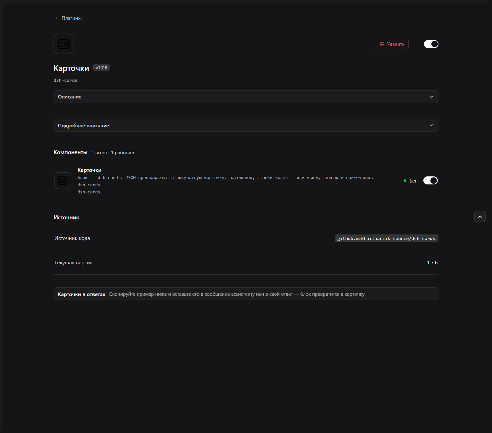
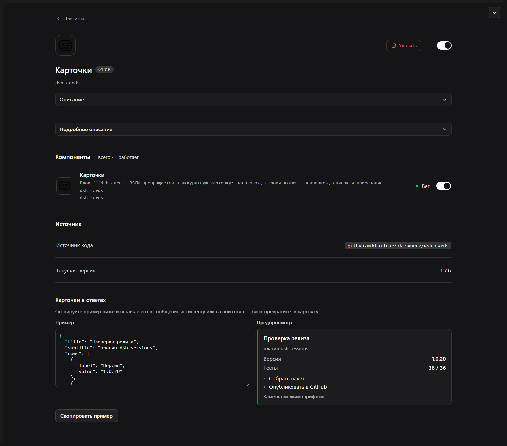

# dsh-cards — подробное описание

Плагин рисует карточки из блоков `dsh-card` в ответах ассистента и даёт этим
карточкам кнопки: скопировать команду, открыть файл, показать папку, открыть
ссылку, опубликовать репозиторий.

## Что это и зачем

| Термин | Что это |
|---|---|
| DSH | DeepSeek Harness — приложение, в котором вы общаетесь с ассистентом |
| Markdown | разметка ответа: заголовки, списки, блоки кода |
| Блок кода | текст между ``` и ```; после слова-языка можно пометить содержимое |
| `dsh-card` | имя блока, которое понимает этот плагин |
| JSON | способ записать данные парами «поле: значение» |

Плагин добавляет к Markdown один язык разметки — `dsh-card`. Внутри блока обычный
JSON, поэтому карточку можно написать руками или попросить ассистента её выдать.
Ничего не компилируется и не исполняется: браузер разбирает JSON и рисует из него
обычные элементы интерфейса.

Зачем JSON, а не свой синтаксис: JSON разбирает сам браузер, ошибка разбора не
роняет интерфейс. Если внутри блока невалидный JSON, плагин просто не рисует
карточку — остаётся исходный текст ответа.

## Как открыть

1. Левая панель → «Плагины».
2. Карточка «Карточки» (пакет `dsh-cards`) → страница плагина.
3. Раздел «Карточки в ответах»: свёрнутая строка со стрелкой, клик раскрывает.
4. Внутри — пример JSON слева, предпросмотр справа, кнопка «Скопировать пример».
5. Внизу страницы раздел «Подробное описание» (этот файл) — тоже сворачиваемый.

Карточки в переписке появляются сами, без открытия плагина.

## Как пользоваться пошагово

**Ассистент выдаёт карточку.**

1. Напишите: «Покажи итог карточкой dsh-card: …» и перечислите, что важно.
2. Дождитесь ответа. Ожидаемый результат: вместо JSON — карточка с заголовком и
   строками.
3. Нажмите кнопки, если они есть. Ожидаемый результат: действие выполнено, под
   кнопками появился итог или понятная ошибка.

**Свой JSON в предпросмотре.**

1. Откройте раздел плагина.
2. Измените JSON в левом поле.
3. Справа появится карточка. Ожидаемый результат: изменения видны сразу, без
   перезагрузки страницы.
4. Нажмите «Скопировать пример» и вставьте блок в сообщение.

**Проверка формы.**

1. Уберите кавычку в JSON.
2. Ожидаемый результат: справа красная строка «Не удалось прочитать блок: …» с
   причиной. Карточка при этом не ломает страницу.

## Примеры

**Полная карточка.**

````
```dsh-card
{
  "title": "Проверка релиза",
  "subtitle": "плагин dsh-sessions",
  "rows": [
    { "label": "Версия", "value": "1.0.20" },
    { "label": "Тесты", "value": "36 / 36" }
  ],
  "list": ["Собрать пакет", "Опубликовать в GitHub"],
  "note": "Заметка мелким шрифтом",
  "tone": "success"
}
```
````

**Команда с копированием.**

```json
{
  "title": "Тесты плагина",
  "command": "node --test test/card.test.mjs",
  "note": "Кнопка «Копировать команду» положит строку в буфер"
}
```

Поле `commands` (массив строк) и поле `code` работают так же и складываются в один
блок: каждая строка с новой строки.

**Файл, папка, ссылка.**

```json
{
  "title": "Материалы",
  "file": "C:/Users/user/Documents/projects/dsh-cards/README.md",
  "folder": "C:/Users/user/Documents/projects/dsh-cards",
  "url": "https://github.com/mikhailnarzik-source/dsh-cards",
  "name": "dsh-cards-readme"
}
```

`file` даёт кнопки «Открыть файл», «Сохранить как…» и «Открыть с помощью…»;
`folder` — «Открыть в папке»; `url` — «Открыть ссылку» и «Скачать файл» (поле
`name` задаёт имя файла; `"download": false` убирает кнопку скачивания). Пути —
полные и внутри разрешённых каталогов: рабочая папка DSH, `~/.dsh`, «Документы»,
«Рабочий стол», «Загрузки». В примере путь условный.

**Публикация репозитория.**

```json
{
  "title": "Публикация",
  "repo": "C:/Users/user/Documents/projects/dsh-cards",
  "note": "git push origin HEAD:main"
}
```

**Свои кнопки.**

```json
{
  "title": "Проверки",
  "actions": [
    { "label": "Тесты", "kind": "run-tests", "target": "C:/Users/user/Documents/projects/dsh-cards" },
    { "label": "Копировать", "kind": "copy", "command": "npm test" },
    { "label": "Открыть README", "kind": "open-file", "target": "C:/Users/user/Documents/projects/dsh-cards/README.md" }
  ]
}
```

## Что вы увидите

**Карточка.** Слева цветная полоса — тон `tone` (`info` синий, `success` зелёный,
`warning` оранжевый, `danger` красный; неизвестный тон становится `info`). Дальше:
заголовок, подзаголовок, строки «подпись — значение», маркированный список,
примечание, блок команды.

**Кнопки.** Ряд под карточкой. Пока действие выполняется — надпись «выполняю…» и
кнопка неактивна. Действия с проверяемым итогом (`git-push`, `git-pull`,
`run-tests`, установка и обновление плагинов) красятся: успех — зелёная кнопка
«<название> снова», ошибка — красная с текстом под кнопками. Копирование меняет
подпись на «Скопировано» на полторы секунды.

**Меню «Открыть с помощью».** Открывается кнопкой с иконкой файла: приложение по
умолчанию, найденные редакторы (VS Code, Cursor, Sublime, Notepad++ и другие),
пункты «Указать программу…» и «Показать в папке».

**Страница плагина.** Свёрнутая строка «Карточки в ответах» с подсказкой; после
раскрытия — два поля («Пример» и «Предпросмотр»), кнопка «Скопировать пример»,
шеврон «Свернуть».


## Как это выглядит



*Рисунок 1. Страница плагина: описание, настройки и кнопки.*



*Рисунок 2. Рабочий раздел плагина: органы управления и результат.*

## Как это устроено

| Часть | Файл | Что делает |
|---|---|---|
| Разметка и кнопки | `client.js` | рендерер блока `conversation.chat.markdown.fence`, карточка на странице плагина, меню редакторов |
| Действия | `index.js` | маршрут `POST /api/dsh-cards/action`, запуск git, тестов, установки плагинов, открытие файлов |
| Эталонный разбор | `lib/card.mjs` | `parseCard` с ограничениями длины; используется тестами как спецификация формы |
| Список приложений Windows | `apps.ps1` | системные ассоциации файлов для «Открыть с помощью» |

Карточка в переписке разбирается в браузере тем же правилом: объект, массивы
`rows`/`list` до 40 элементов, неизвестный `tone` → `info`. Ошибка разбора
возвращает `null`, и остаётся стандартный рендер блока кода.

## Частые ошибки и что делать

| Симптом | Причина | Что делать |
|---|---|---|
| Блок остался текстом | блок называется не `dsh-card`, JSON невалиден или карточка пустая | Проверьте имя языка и JSON в предпросмотре |
| «Не удалось прочитать блок: Unexpected token…» | синтаксис JSON | Уберите висячие запятые, комментарии, одинарные кавычки |
| Строки/список обрезаны | больше 40 элементов | Сократите список; карточка не для таблиц |
| Кнопки не появились | нет полей `file`/`folder`/`url`/`repo`/`command`/`actions` | Добавьте нужное поле |
| «путь вне рабочей папки» | путь вне разрешённых каталогов | Укажите полный путь внутри рабочей папки DSH |
| «каталог не найден» | путь существует только на другой машине | Проверьте путь в проводнике |
| «нет ассоциации, открыто в …» | у расширения нет приложения по умолчанию | Это не ошибка: файл открыт в редакторе |
| «не удалось скачать: …» | ссылка недоступна или не http(s) | Проверьте ссылку и сеть |

## Ограничения и безопасность

**Форма.** Эталонный разбор (`lib/card.mjs`) ограничивает длины, чтобы карточка не
превращалась в простыню:

| Поле | Предел |
|---|---|
| `title` | 200 символов |
| `subtitle` | 300 символов |
| `value` (в `rows`) | 400 символов |
| элемент `list` | 400 символов |
| `note` | 600 символов |
| `rows`, `list` | по 40 элементов |

В браузере длинные строки переносятся, а не обрезаются, поэтому пишите коротко.

**Действия.**

| Вид | Что реально запускается |
|---|---|
| `git-push` («Опубликовать» и свои кнопки) | `git push origin HEAD:main` в каталоге `target` |
| `git-pull` | `git pull --rebase origin main` |
| `run-tests` | `node --test` в каталоге `target` |
| `dsh-plugin-add` / `dsh-plugin-update` | `dsh plugin --profile desktop add/remove` только для `github:mikhailnarzik-source/*` |
| `copy`, `copy-text` | буфер обмена через хост |
| `download-file` | `http`/`https` → файл в «Загрузки» |
| `open-file`, `open-folder`, `open-url`, `reveal-file`, `save-as`, `open-with`, `pick-editor`, `open-in-editor` | открытие через Windows; только http(s) для ссылок |

- Файловые действия разрешены только внутри рабочей папки DSH и нескольких
  пользовательских каталогов (список задан в `index.js`). Остальное отклоняется.
- Кнопки появляются из данных карточки, но нажимает их человек. Автоматического
  выполнения нет.
- `--force`, произвольные git-команды и команды оболочки из карточки не
  выполняются: набор действий фиксирован.
- Имя скачиваемого файла очищается от недопустимых символов и обрезается до 80
  символов.
- Регистрация рендерера идёт с приоритетом 5: если слот блоков кода одиночный и
  занят, система оставит свой рендерер и загрузка пройдёт штатно.

## Связанные плагины

- `dsh-polish` — общий слой оформления: делает кнопки и фокус заметнее.
- `dsh-review` — ревью изменений и git-действия с подтверждением.
- `dsh-sessions` — синхронизация истории; карточка «Проверка релиза» — его пример.
- `dsh-github-safe` — действия с GitHub через плагин, а не через git.
- `dsh-team`, `dsh-expenses`, `dsh-notify`, `dsh-compact` — могут выдавать итог
  карточкой.

## Проверка

```powershell
node --test test/card.test.mjs
```

Тесты проверяют разбор полной карточки, замену неизвестного тона, безопасность
битого JSON, отказ пустой карточке, отбрасывание мусора и обрезку списков до 40.
